# Paul's Python Course

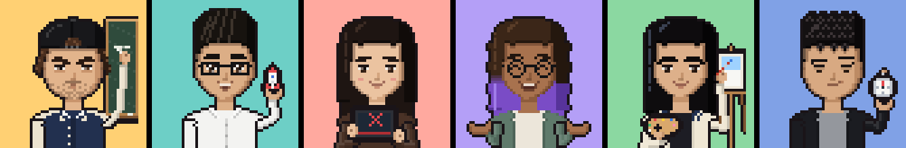

So I teach Python to my friends (Neil helps me out from time to time), and this is the website for it. Everyone in it is a real person, because the six people in that picture are actually us.

You can **[play it here](https://bouwles.github.io/pauls-python-course/)** without signing up for anything, you just pick who you are and start.

In the game I've turned an old clocktower into a code school, and you start on the ground floor printing a sign for the door, then work your way up through nine floors and 116 projects until you've written a neural network from scratch and a tiny GPT, trained a crab to race and ended up on the roof building something of your own. All of it takes about 410 hours, so there's no rush.

## Pick who you are

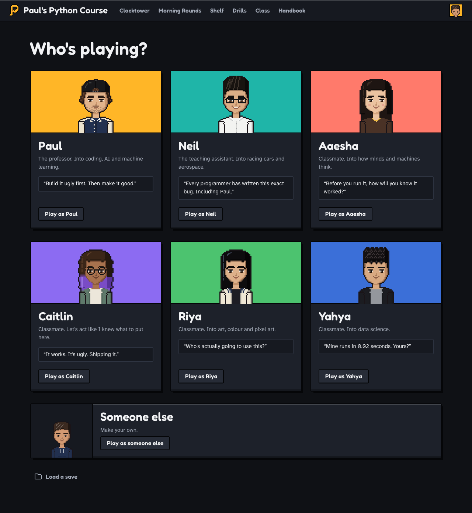

You can play as any of us or make your own avatar, and everyone learns the same Python either way, it's just the story around it that changes. If you play as Neil, for example, Neil's projects become yours, the buggy code you end up fixing turns out to be your own old code, everyone calls you Neil, and I'm the one giving you hints.

| | | |
| --- | --- | --- |
| 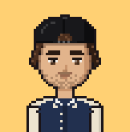 | **Paul** | That's me. Into coding, AI and machine learning. |
|  | **Neil** | Helps me teach. Into racing cars and aerospace. |
| 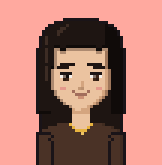 | **Aaesha** | Into how minds and machines think. |
|  | **Caitlin** | Let's act like I knew what to put here. |
|  | **Riya** | Into art, colour and pixel art. |
|  | **Yahya** | Into data science. |

## Climb the tower

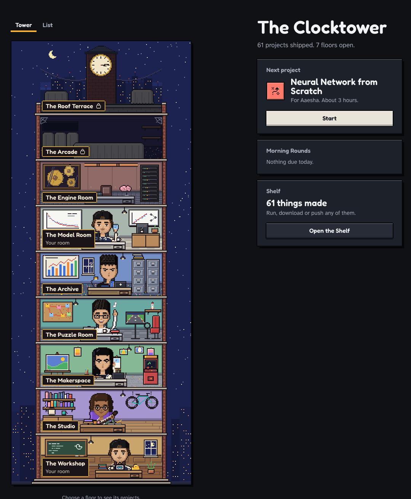

Each floor is an Act and we've all got a room somewhere in the building, and the locked floors keep their furniture under dust sheets until you get up there (if you already know some Python, there's a placement test that can open the early floors for you).

| Floor | Room | What you learn | Some of what you build |
| --- | --- | --- | --- |
| Roof | The Roof Terrace | Capstones and a portfolio | Paper Reproduction, Your Own Project |
| 7 | The Arcade | Reinforcement learning | Q-Learning Crab, Snake AI, CartPole with DQN |
| 6 | The Engine Room | Deep learning and AI | Neural Network from Scratch, Tiny Autograd Engine, Tiny GPT |
| 5 | The Model Room | Machine learning | Spam Filter, Movie Recommender, Fishing Forecast |
| 4 | The Archive | Data science | Census Explorer, Earth Data Map, Data Story |
| 3 | The Puzzle Room | Algorithms and data structures | Hash Map from Scratch, Maze Solver, Sudoku Solver |
| 2 | The Makerspace | Real-world Python | Snake, Flask Web App, Chat Bot |
| 1 | The Studio | Fluent Python | Quiz App, Bank Account System, Text Adventure Engine |
| Ground | The Workshop | Foundations | Bill Splitter, To-Do List, Rock Paper Scissors |

## How a project goes

Every project starts with one of us needing something, like Caitlin picking the restaurant for class dinner when there are six of us and one bill, and it took twenty minutes last time to settle who had the extra garlic bread, so you build a bill splitter.

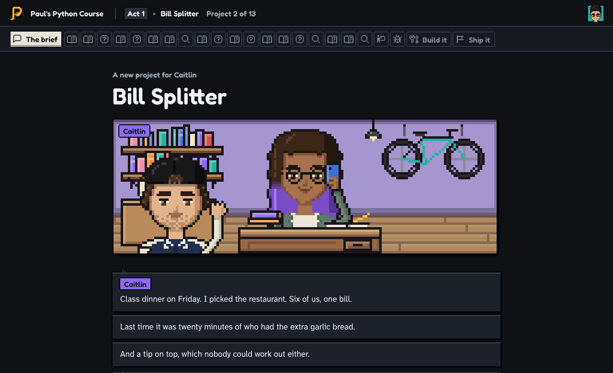

You pick up the ideas as you go, with short explanations, examples you can run and change, and questions that make you guess what some code will print before you get to run it.

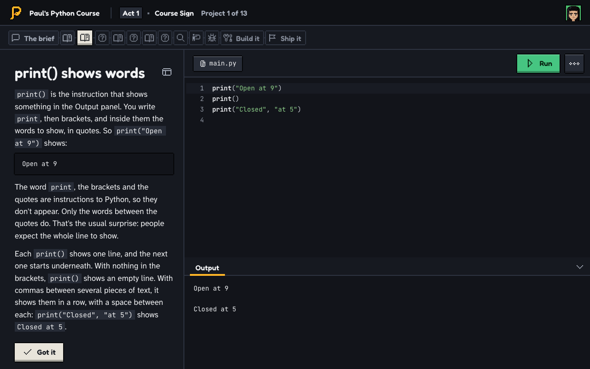

At some point somebody's code turns up with a mistake in it, like Yahya's tip program, which says a bill of 20 with a 10 per cent tip comes to 20.10, so you find the bug and fix it (and I'll have something to say about the variable called `c`).

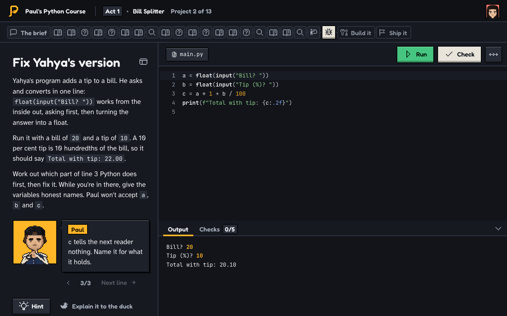

Then you write the program yourself and the tests check it, and if you get stuck there are hints that give away a little more each time, or a rubber duck you can explain the problem to, although it won't answer you.

Once the checks pass you ship it and it goes on your Shelf, where you can download everything as one repository, push it to GitHub or send a friend a link that runs it in their browser.

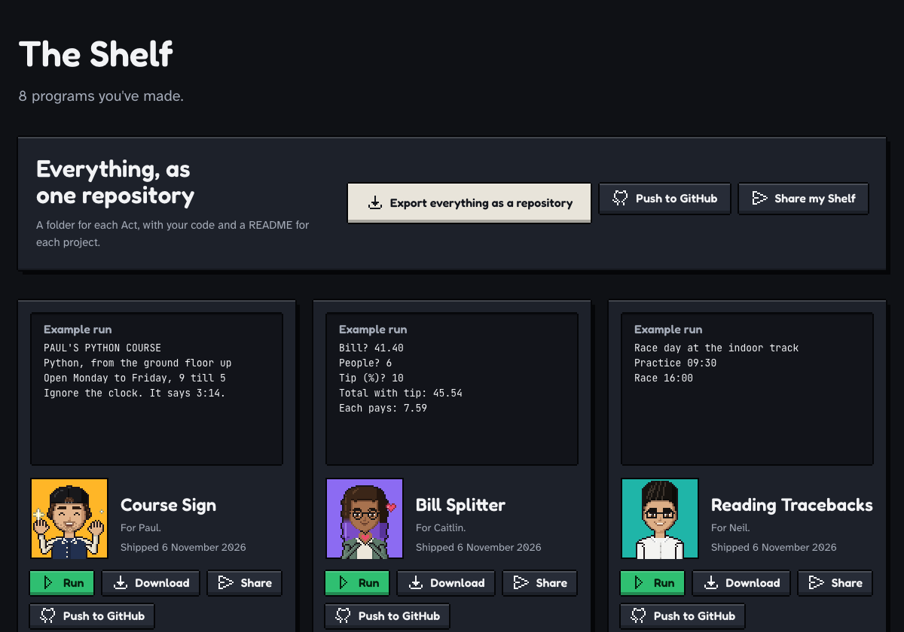

Python runs right there in the browser so you don't have to install anything to get going, but some of the later projects need more than a browser can do, like PyTorch and Pygame, so you build those on your own computer and paste the test results back in.

## Around the projects

**Morning Rounds** brings each idea back a day or two after you first use it, and then less and less often as it sticks.

**Drills** are five quick tasks against the clock, and Yahya has set the time to beat on every single one of them.

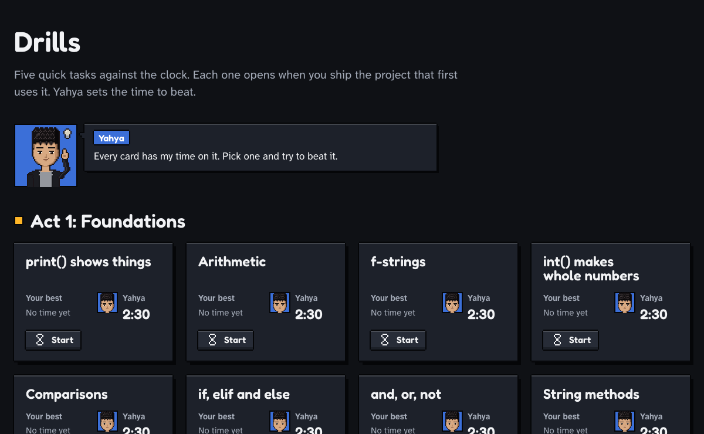

**The Arcade League** is a race every week for the crabs you train in Act 8, where your crab runs on the same seeds as everyone else's and the lowest average number of moves wins, and since the rest of us are on the table too there's always someone to beat.

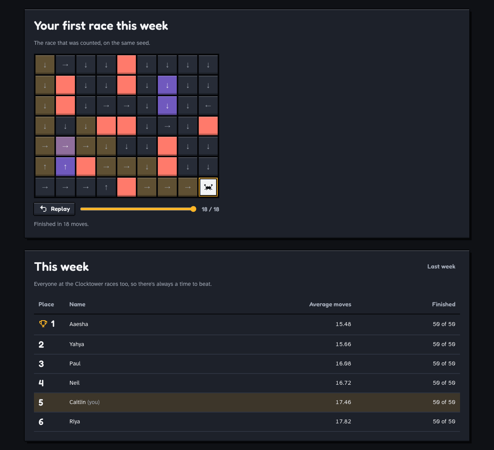

**Certificates** are for finishing an Act, and they're proper ones with an engraved border, a gold seal and my signature on them, which you can save as a picture or print on a sheet of A4.

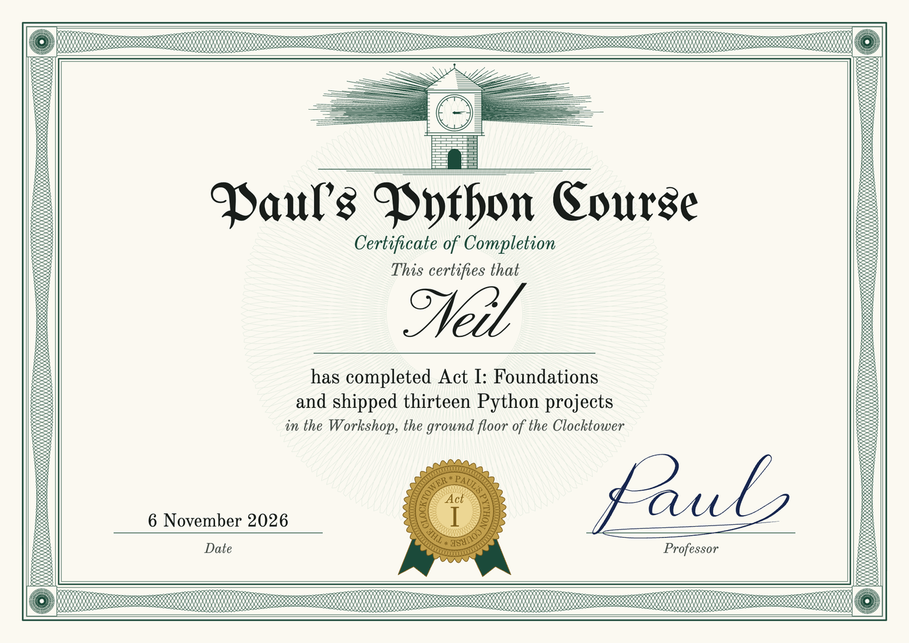

## Classes

This part is for when I'm teaching: I make a class, choose which projects to set and send everyone a join link, and when they've had a go they send me a progress link, which adds them to my register with their code there for me to read. Neil gets a co-teacher link with the same class on it, and I can share the League table the same way.

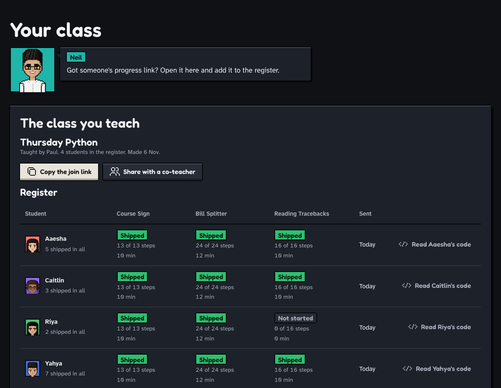

## A couple of other things

You don't need an account for any of this, because your progress stays in your browser and if you want to carry on somewhere else you just take a save with you, as a file or a line of text, and a class lives entirely in its link.

All the art is drawn in code as well, so everyone is put together pixel by pixel from a description of how they look, with 135 gestures to choose from, and every room in the tower is built the same way.
